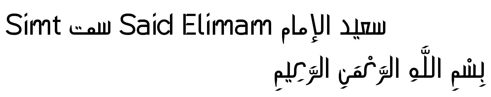

# Simt Font

Project release **0.3.0** · Font software version **1.000**

A Latin and Arabic typeface by Said Elimam on the theme of direction, compass and space.
Simt (سمت) means azimuth, the bearing a traveller holds.



## Author

- **Designer:** Said Elimam
- **Website:** <https://saidelimam.com>
- **Contact:** <contact@saidelimam.com>

## License

This Font Software is licensed under the **SIL Open Font License, Version 1.1**
(see `OFL.txt`, full text at <https://openfontlicense.org>).

Copyright (c) 2026 Said Elimam.

No Reserved Font Name is set, so modified versions may keep the name
"Simt Font" provided the OFL conditions are met (plainly declare the
derivation, ship the license, do not sell the fonts by themselves).

## What's included

- `fonts/ttf/` — SimtFont-Regular.ttf and SimtFont-Bold.ttf (install these on desktop)
- `fonts/webfonts/` — SimtFont-Regular.woff and SimtFont-Bold.woff (for websites)
- `simt-specimen.html` — open it in a browser to type and test the font
- `documentation/previews/` — character-set overviews and design comparison sheets
- `sources/` — the Python build scripts and OpenType feature files
- `sources/build.sh` — one-command reproducible build
- `requirements.txt` — pinned fontTools build dependency
- `scripts/check-integrity.py` — offline verification script (checksums, name table, license)
- `scripts/package_google_fonts.py` — builds the exact `ofl/simtfont` contribution package
- `google-fonts/` — Google Fonts metadata and article templates
- `AUTHORS.txt`, `CONTRIBUTORS.txt` — author and contributor records
- `checksums.sha256` — SHA-256 manifest of the font binaries
- `OFL.txt`, `NOTICE` — license and provenance notices

## What's new in 0.3.0

- Set the project release to `0.3.0` and the font software version to `1.000`.
- Credit Said Elimam as the designer, manufacturer and author, with the public
  website and contact address in the font name table and contribution metadata.
- Add the Google Fonts package, article, checksum-pinned QA workflow and opt-in
  reviewed pull-request submission.
- Align the upstream project with `sources/`, `documentation/`, author and
  contributor records, and a one-command build script.
- Correct the SIL Open Font License name-table declarations and regenerate the
  committed TTF/WOFF binaries from the parametric sources.

## The design rules

1. **Bearing wedges.** Every stem and Arabic tooth starts with a cut at one fixed angle.
   It rises to the right in Latin and to the left in Arabic, the reading direction of each script.
2. **Bearing notches.** Where a bowl or arm leaves a stem (n, m, h, d, b, p, q, E, F, L, P, B, D),
   a narrow diagonal notch opens the join. It works as an ink trap at small sizes.
3. **Horizon finals.** Arabic final forms sweep low and thin to a fine tip.
4. **Matched heights.** Arabic teeth sit on the Latin x-height and alef and lam reach the
   Latin cap height, so both scripts look the same size in a mixed line.

## Technical specifications

- 1000 units per em; x-height 500, cap height 700, ascender 730
- ~360 glyphs per weight, ~250 characters
- Latin: Basic Latin, French and Western European accented letters, Œ œ æ, € and common symbols
- Arabic: full alphabet U+0621–U+064A, Persian letters پ چ ژ ک گ ی, lam-alef ligatures,
  harakat (fatha, kasra, damma, tanwin, sukun, shadda), hamza and madda marks, superscript alef,
  Arabic-Indic digits ٠–٩, Arabic comma, semicolon and question mark, tatweel
- OpenType: `init`, `medi`, `fina` (contextual forms), `rlig` (lam-alef), `mark` and `mkmk`
  (vowel placement, including stacked marks such as shadda + fatha), `kern` (Latin), GDEF classes
- Vertical metrics: typographic metrics with USE_TYPO_METRICS on, hhea matching them for equal
  line height on Mac and Windows; win metrics cover every glyph so nothing clips
- `gasp` set for smooth rendering (the font is unhinted); `meta` table declares Latin and Arabic
- Tested with HarfBuzz shaping (the engine used by Chrome, Firefox, Android and LibreOffice)

## Using it on the web

```css
@font-face { font-family: "Simt Font"; src: url("SimtFont-Regular.woff") format("woff"); font-weight: 400; font-display: swap; }
@font-face { font-family: "Simt Font"; src: url("SimtFont-Bold.woff") format("woff"); font-weight: 700; font-display: swap; }
body { font-family: "Simt Font", system-ui, sans-serif; line-height: 1.6; }
:lang(ar) { line-height: 1.8; }  /* Arabic marks and descenders need a little more room */
```

## Rebuilding

Requires Python 3.10+. From `simt-font/`:

```bash
./sources/build.sh
```

The script creates a local virtual environment, installs the pinned requirements, and writes
TTF and WOFF files to `fonts/`. All proportions live in `sources/latin.py` and
`sources/arabic.py`; stroke weights are in `WEIGHTS` in `sources/build.py`.

## Verification

The integrity script is offline and uses only the Python 3 standard library:

```bash
python3 scripts/check-integrity.py
```

It checks the SHA-256 manifest of every font binary, parses each font's name
table (family, style, PS name, license and license URL entries), and verifies the
license files are present and intact. `./gradlew :simt-font:check` runs the same
script through the `checkFontIntegrity` task.

## Google Fonts contribution CI

The `google-fonts` GitHub Actions workflow builds the sources, verifies the released binaries,
packages `ofl/simtfont`, and runs Fontspector's `googlefonts` profile. A normal manual run
uploads the package and QA reports without credentials. Setting `submit=true` additionally
opens or updates a pull request in `google/fonts`, but only after every QA check passes.

Before the first submission:

1. [Open an Add Font issue](https://github.com/google/fonts/issues/new?assignees=&labels=I+New+Font%2C+II+Submission&template=1_add-font.md&title=Add+%5BFont+Name%5D)
   in `google/fonts`; Google Fonts requires an issue before a font PR.
2. [Sign the Google Contributor License Agreement](https://cla.developers.google.com/about)
   with the GitHub account and email used for the contribution.
3. Fork `google/fonts`. The workflow defaults to `<github-login>/fonts`; a differently named
   fork can be supplied in the `fork` input.
4. Register a
   [designer profile](https://docs.google.com/forms/d/e/1FAIpQLSeMwHN8J213ZaxHrr5lHCrX56HY_NjGrWB8o604g98YxuMrdA/viewform)
   for the exact credit `Said Elimam` with the email registered with the CLA.
5. Create a `google-fonts` GitHub environment, preferably with a required reviewer, and add
   `GOOGLE_FONTS_TOKEN`. Use a fine-grained PAT with Contents read/write on your fork and
   Pull requests read/write on `google/fonts`. Optionally add `GOOGLE_FONTS_EMAIL` with the
   email registered with the CLA.

Run the workflow from `main`, enter the issue number and fork, and enable `submit` only when
ready. The workflow creates a reviewed PR; Google Fonts staff decide when to merge and publish
the family. See the [official contribution guide](https://googlefonts.github.io/gf-guide/making-pr.html).

## Status and next steps

This is a complete, working first release, generated parametrically from the design rules.
Before a commercial or public release, these steps are recommended:

- **Refine outlines by hand** in Glyphs or FontLab: optical corrections, curve tension, and
  shapes that still read as schematic (ain, the Arabic digits 2, 3 and 4, quotation marks).
- **Native-reader testing** of the redesigned hah and kaf families with Arabic and Persian readers.
- **Remove overlaps.** Strokes overlap by design (valid TrueType, flagged correctly), but merging
  them gives cleaner outlines and smaller files.
- **Spacing and kerning.** Latin has basic class kerning; Arabic needs its own kerning pass.
- **WOFF2.** Create with `fonttools ttLib.woff2 compress SimtFont-Regular.ttf` (needs `brotli`).
- **Hinting.** Run ttfautohint for crisper Windows rendering at small sizes.
- **Wider coverage.** Persian digits ۴ ۵ ۶, Urdu letters, Latin Extended-A (Central European),
  ¡ ¿ ß Æ and more symbols.
- **Variable font.** Add the planned axes: weight, slit opening (SLIT) and horizon length (HRZN).
- **Google Fonts QA.** Fix every failure reported by the `google-fonts` workflow and test in
  Word, InDesign, macOS and Windows.
